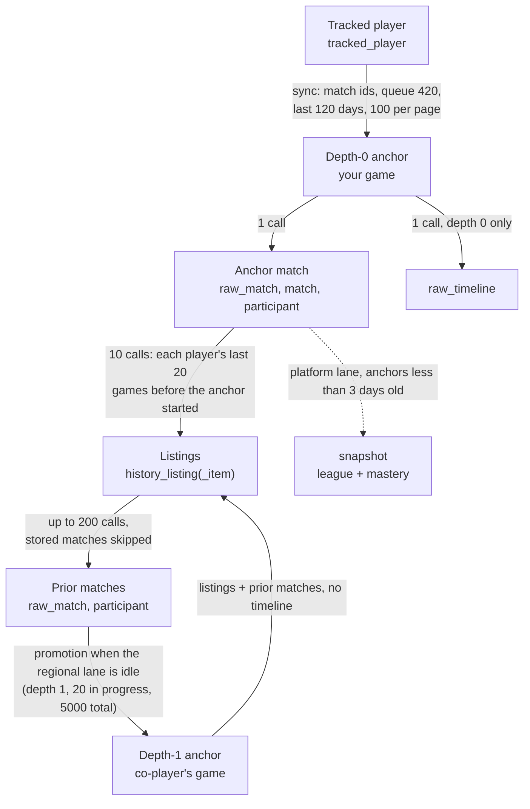
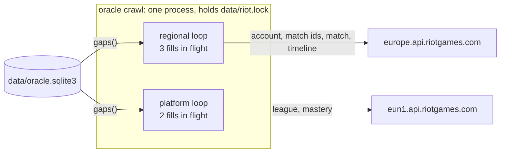

# Data pipeline: pulling matches from Riot

## Overview

**Use `oracle crawl`.** There is no separate "fetch this player's history" command. A crawl compares what the database should contain for every **tracked** player with what it already holds, and fetches the difference. The first crawl after `oracle track` is the backfill. Every later crawl is incremental.

For each tracked player, a crawl pulls:

1. **Their ranked solo/duo games (queue 420) from the last 120 days.** Match IDs come in pages of 100, with a checkpoint after each page. Each game becomes a depth-0 **anchor**, which will later be a training row.
2. **Per anchor:**
   - the match itself (1 call);
   - a **listing** for each of the 10 participants: their last 20 ranked games that started before the anchor (10 calls);
   - those prior matches (up to 200 calls; matches already stored are skipped).
3. **The timeline** of each depth-0 anchor (1 call).
4. **Rank and mastery snapshots**, only for players in anchors that started within the last 3 days.
5. **Promotion.** Once everything above is done, co-players' prior games are promoted to depth-1 anchors and go through step 2. This is bounded: max depth 1, at most 20 incomplete at a time, 5,000 anchors in total, and only games inside the 120-day window.

**Only tracked players get synced.** To pull someone else's games, `oracle track` them. Everyone else appears only as a participant or inside a history listing.

## Quick start

```bash
cp .env.example .env              # set RIOT_API_KEY, RIOT_PLATFORM (e.g. eun1)
oracle track "Name#TAG"           # 1 call: Riot ID -> PUUID. Fetches no games yet.
oracle crawl --max-calls 50       # smoke test (well under a minute)
oracle status                     # progress, gaps, estimate, failures. 0 calls
oracle crawl                      # the backfill. Ctrl-C any time; rerun to resume
oracle crawl --forever            # stay up, re-check for new games every 15 min
```

Run `oracle …` with the virtualenv active, or `uv run oracle …` without it. Both work from any folder in the repo, because the CLI walks up the directories to find the nearest `.env`.

**What a first run costs** (one tracked player, default settings):

| Phase | Calls | Time at ~2,700 calls/h |
|---|---|---|
| Key check + sync | 1, plus 1 per 100 games | seconds |
| ~100 own games as anchors | ~200 each (1 + 10 + up to 200, less with overlap) → ~20k | ~7–8 h |
| Timelines | 1 per own game | minutes |
| Snapshots (games < 3 days old) | 2 per player | runs in parallel, on its own budget |
| Depth-1 promotion | ~100 per anchor, up to ~4,900 anchors | days (capped at 50k calls per UTC day) |

The ~2,700 calls/h assumes the default limit of 100 calls per 120 s on the regional (`europe`) budget. The limiter uses 95 % of that, about one call every 1.3 s. The real limits of a personal key are learned from response headers. Anchors are worked newest first, so your most recent games are completed first.

> A plain `oracle crawl` does **not** stop after your own games: it continues into depth-1 promotion. Use `--max-calls` to bound a session, and the `estimate` line of `oracle status` to see what is left.

## Command reference

| Command | API calls | What it does |
|---|---|---|
| `oracle track "Name#TAG"` | 1 (account-v1) | Adds the player's PUUID to `tracked_player`. Takes the key lock. |
| `oracle untrack "Name#TAG"` | 0 | Removes the player and their sync cursor. Their data stays, and their existing anchors are still completed. |
| `oracle tracked` | 0 | Lists tracked players. |
| `oracle crawl` | 1 + the work | Fills gaps until it drains, runs out of budget, or hits an error. The 1 extra call is the key check. |
| `oracle crawl --max-calls N` | ≈ N | Stops this run after N calls, counting the key check. Calls already in flight can push it slightly over. |
| `oracle crawl --forever` | ongoing | Never drains. Looks for new gaps every 60 s and re-syncs tracked players every 15 min. Also runs the **live watcher**: every 60 s it checks each tracked player for a live game (1 call each on the platform lane). For a new ranked game it snapshots rank and mastery for all 10 players at game start (20 calls) and archives the spectator data in `live_game`. These are the only **clean pre-game** rank and mastery values, so keep it running while you play. |
| `oracle -v <command>` | — | Debug logging. This is a global flag, so it goes **before** the subcommand. |
| `oracle status` | 0 | Tracked players, complete anchors per depth, gaps by kind, calls-left estimate, failures, calls today, last run. Safe to run while a crawl is running. |
| `oracle reproject` | 0 | Rebuilds `match`/`participant` from the stored raw JSON after a parser change (bump `PARSER_VERSION` first). |
| `oracle dataset [--out DIR]` | 0 | Builds the training bundle (`matches.parquet`, `seats.parquet`, `manifest.json`) from complete anchors into `training/data/<dataset id>/`. Read-only, safe while a crawl runs. See `training/README.md`. |
| `oracle retry-failed` | 0 | Clears all `fetch_failure` rows, so the next crawl retries deferred and parked gaps. |
| `oracle bot` | as `crawl --forever`, plus prophecies | Replaces `oracle crawl --forever` (same process, one key lock) and posts a prophecy to Discord for each ranked game of a tracked player. See [Discord bot](Discord-Bot.md), which also covers `oracle prophesy` and `oracle prophecies`. |
| `docker compose run --rm db-init` | 0 | Creates `data/oracle.sqlite3` without Python. Optional: any `oracle` command also creates it. |

A crawl ends with a one-line summary: `run #N: <calls> calls; <results per gap kind>; <k> anchors promoted; stop: <reason>`. The stop reason is one of `drained`, `budget`, `daily_cap`, `error`, `interrupted` (Ctrl-C) or `stopped` (an external stop, meant for the future bot). During a run the crawl only logs learned limits, retries and failures. Watch progress with `oracle status` in a second terminal.

## Key concepts

| Term | Meaning |
|---|---|
| **Tracked player** | A seed in `tracked_player`. Only these players' match lists are synced. |
| **Anchor** | A match that becomes a training row (`anchor`). **Depth** 0 is a tracked player's own game. Depth 1 is promoted from a depth-0 anchor's history. |
| **Listing** | "The n most recent queue-420 games of player P that started before time T" (`history_listing` + `_item`). Fetched from match-v5 IDs with `endTime=T&count=n`. Keyed by time, not by anchor, so the bot can reuse it live. |
| **Gap** | One API call's worth of missing data. Gaps are derived from the database on every refill (`_frontier.py`). There is **no job queue**. |
| **Fill** | Fetching one gap: one API call, then one SQLite transaction. |
| **Lane** | One routing host with its own rate budget: regional (`europe`) for account and match-v5, platform (`eun1`) for league and mastery. |
| **Snapshot** | A league or mastery response. These endpoints only return the *current* state, so each one is a timestamped sample that can't be fetched again later. |

## How a crawl works



1. **Key check.** The crawl re-resolves the first tracked Riot ID (1 call). If the PUUID differs from the stored one, it refuses to run (`KeyMismatch`).
2. **Two lane loops run in parallel**, one per rate budget. Each loop asks `Mirror.gaps()` for the most valuable missing pieces, keeps a few fills in flight, and repeats.



3. **Priority on the regional lane:**
   1. Syncs that are due.
   2. Anchors in `(depth, seq)` order, one anchor at a time: its match, then its 10 listings, then the prior matches.
   3. Timelines.
   4. When nothing is left, **promotion** creates new anchors and the loop continues.

   Because it works depth-first, a crawl that stops at any point leaves the most *complete* anchors for the calls spent. Your new games always come before depth-1 work. On the platform lane, snapshots are taken newest anchor first.
4. **Checkpointing.** A fill waits for the HTTP response, then writes everything in one transaction with no `await` inside it. A Ctrl-C or crash therefore leaves either the whole result or nothing, and the next run recomputes the gaps. At most the ~5 in-flight calls are repeated.
5. **Sync cycle.** The first cycle lists games from now minus 120 days. A page with fewer than 100 IDs ends the cycle. The next cycle is due 15 min later and starts 3 h before the previous one began, to catch games that were still running.
6. **Rate limiting** (`_limiter.py`):
   - Limits are learned from the `X-App-Rate-Limit` and `X-Method-Rate-Limit` headers. The default is `20:1,100:120` until the first response arrives.
   - Only 95 % of each window is used, with 1 s of padding, and background calls are spaced evenly.
   - An application 429 freezes the lane for `Retry-After` and halves the pace. Three of them within 10 min pause background calls for 5 min.
   - A request that gets a 4th 429 is given up as transient.
7. **Failures:**

| Response | Effect |
|---|---|
| 404 on a match or timeline | Recorded as a fact (`outcome='gone'`) and never requested again |
| 5xx or network error (after 3 retries), or a 4th 429 | **Deferred**: retried after 10 min·2^attempts (20, 40, 80… min). After 6 attempts it is **parked** until `oracle retry-failed` |
| 401 / 403 | The crawl stops (`AuthError` / `ForbiddenError`) |
| Any other 4xx, or an unexpected 404 | The gap is parked and the **whole crawl stops** (`BadRequestError`). A rerun skips the parked gap |

## Where the data lands

Everything goes into `data/oracle.sqlite3`. The database is in WAL mode, so you can read it while a crawl writes. Any `oracle` command that opens the database upgrades an older one in place (schema v1 to v2 added the `prophecy` table) and keeps all rows. Timestamps are epoch **milliseconds** (`_ms` columns). Champions are numeric `champion_id`s; there is no Data Dragon name mapping yet.

| Family | Tables | Contents |
|---|---|---|
| Facts (insert-only) | `raw_match`, `raw_timeline` | zlib-compressed verbatim JSON (~5 KB per match, ~100 KB per timeline); `outcome` is `ok` or `gone` |
| | `history_listing`, `history_listing_item` | `(puuid, queue_id, before_ms)` → ordered `match_id`s (`ord` 0 = most recent) |
| | `snapshot` | `kind`, `puuid`, `taken_at_ms`, JSON `payload` (`[]` = unranked) |
| | `live_game` | Archived spectator payloads, written by the live watcher of `oracle crawl --forever` and `oracle bot` |
| Projection (rebuildable) | `match` | `queue_id`, `game_start_ms`, `game_duration_s`, `patch`, `winning_team_id`, `is_remake` |
| | `participant` | 10 rows per match: `puuid`, `team_id`, `champion_id`, `team_position`, `win`, `kills`, `deaths`, `assists`, `damage_to_champs`, `damage_taken`, `gold_earned`, `cs`, `vision_score`, `champ_level` |
| Bookkeeping | `tracked_player`, `sync_cursor`, `anchor`, `fetch_failure`, `crawl_run` (with `spec_json`), `api_call_stat` | What we collect, retries, run history, calls per UTC day |
| Bot | `prophecy` | One row per live game the bot prophesied about (`pending`, `posted`, `failed`), with the stored prophecy and the Discord message id. See [Discord bot](Discord-Bot.md) |
| Views | `anchor_info`, `anchor_history`, `league_entry` | The read side |

**`anchor_history` is the entry point for features.** It has one row per (anchor, participant, prior game). It re-checks `prior_start < anchor_start`, so it is leak-free by construction. Key columns: `anchor_match_id`, `anchor_start_ms`, `puuid`, `anchor_champion_id`, `games_ago`, `prior_is_remake`, plus the prior game's stats.

### Why participants are kept

Nothing is deleted after a game or after analysis, and the other 9 players' rows are needed:

- **The model needs all 10 players.** The win model predicts *team* win probability from all 10 players: their champions, roles, and recent form (their prior games). With only tracked players' rows, it could only learn "how do I do on this champion".
- **Deleting breaks the pipeline.** Finished matches are fetched exactly once. A deleted match would become a gap again and be re-fetched, and `anchor_history` joins through participant rows.
- **Storage is small:** about 6–7 KB per match (compressed JSON plus 10 participant rows), so ~70 MB per 10k matches.

To spend fewer **API calls**, change these `DatasetSpec` settings (see Configuration) instead of deleting data: `max_depth=0`, a lower `history_n`, or `timelines_max_depth=-1`.

### Example queries

```sql
-- My last 20 ranked games
SELECT p.match_id, datetime(p.game_start_ms / 1000, 'unixepoch') AS started_utc,
       p.champion_id, p.team_position, p.win, p.kills, p.deaths, p.assists, p.cs, m.patch
FROM tracked_player t
JOIN participant p ON p.puuid = t.puuid AND p.queue_id = 420
JOIN match m       ON m.match_id = p.match_id
WHERE m.is_remake = 0
ORDER BY p.game_start_ms DESC LIMIT 20;

-- Anchor completeness: want listings = 10 and prior_fetched = prior_games
SELECT ai.depth, ai.match_id, count(DISTINCT h.puuid) AS listings,
       count(li.match_id) AS prior_games, count(r.match_id) AS prior_fetched
FROM anchor_info ai
JOIN participant p                ON p.match_id = ai.match_id
LEFT JOIN history_listing h       ON h.puuid = p.puuid AND h.queue_id = ai.queue_id AND h.before_ms = ai.before_ms
LEFT JOIN history_listing_item li ON li.puuid = h.puuid AND li.queue_id = h.queue_id AND li.before_ms = h.before_ms
LEFT JOIN raw_match r             ON r.match_id = li.match_id
GROUP BY ai.seq ORDER BY ai.depth, ai.seq;

-- Calls today (UTC), by host / endpoint / outcome
SELECT routing, endpoint, outcome, sum(calls) AS calls
FROM api_call_stat WHERE day = date('now')
GROUP BY routing, endpoint, outcome ORDER BY calls DESC;
```

From pandas (pandas isn't a project dependency yet):

```python
import pandas as pd
from oracle.config import Settings
from oracle.mirror import Mirror

con = Mirror.read_only(Settings.from_env(require_key=False).db_path)   # no lock, never blocks the crawler
hist = pd.read_sql("SELECT * FROM anchor_history WHERE games_ago < 20 AND prior_is_remake = 0", con)
form = hist.groupby(["anchor_match_id", "puuid"]).agg(games=("win", "size"), win_rate=("win", "mean"))
```

To read fields that aren't projected into `match`/`participant`, decode the raw JSON with `json.loads(zlib.decompress(payload))`.

## Configuration

`.env` is git-ignored; `.env.example` is the template. Real environment variables override `.env`.

| Variable | Purpose |
|---|---|
| `RIOT_API_KEY` | `RGAPI-…`. Needed only by `track` and `crawl` |
| `RIOT_PLATFORM` | e.g. `eun1`. Required by every command. The regional host (`europe`) is derived from it |
| `ORACLE_DATA_DIR` | Default `./data`, relative to the `.env` file. Holds `oracle.sqlite3` and `riot.lock` |
| `HOST_UID` / `HOST_GID` | Linux only: owner of the files `db-init` creates |

**Dataset settings have no CLI flags yet.** They are `DatasetSpec` defaults in `src/oracle/mirror/gaps.py`, used by both `crawl` and `status`. Each run's settings are recorded in `crawl_run.spec_json`.

| Field | Default | Meaning |
|---|---|---|
| `queue_id` | 420 | Ranked solo/duo |
| `history_n` | 20 | Prior games per player per anchor (raised from 10: richer form and champion stats, about 2× the calls) |
| `lookback_days` | 120 | How far back the first sync goes. Promotion also ignores older games |
| `max_depth` / `max_anchors` / `wip_anchors` | 1 / 5000 / 20 | Promotion bounds |
| `timelines_max_depth` | 0 | Timelines for anchors up to this depth (−1 = none) |
| `snapshot_window_days` | 3 | Snapshots only for anchors this recent |
| `sync_poll_s` | 900 | How often a tracked player's match list is re-checked |

Run budgets live in `CrawlBudget` (`src/oracle/crawl.py`): `max_calls_per_day=50_000` across runs, concurrency 3 on the regional lane and 2 on the platform lane, and `idle_poll_s=60`.

## Gotchas & limitations

- **One platform only.** League and mastery calls always go to `RIOT_PLATFORM`, so all tracked players must be on that server.
- **A backfill gets almost no rank data.** league-v4 and mastery only know "now". A snapshot is clean (leak-free) for a game only if it was taken **before that game ended**. Clean snapshots come from the live watcher in `oracle crawl --forever`, which captures all 10 players at game start. Snapshots taken after a game (for anchors under 3 days old) are approximate and leaky. Keep `--forever` running while you play to build clean coverage.
- **`history_n` must equal what the bot uses live.**
  - Raising it turns every shorter listing back into a gap, so every anchor is re-listed.
  - Lowering it doesn't refetch anything, but `anchor_history` still returns the longer listings, so filter on `games_ago < n`.
- **Raising `lookback_days` later doesn't backfill further.** The sync cursor only moves forward. To re-sync, `untrack` and then `track` again; stored data is kept and duplicates are ignored.
- **A rerun within 15 min of the last sync won't look for new games**, because the next sync isn't due yet.
- **An unexpected 4xx, or a 401/403, stops the whole crawl.** Development keys expire every 24 h, which shows up as a 401.
- **`--max-calls` can overshoot slightly.** In-flight calls are cancelled at the budget, and the next run repeats them.
- **One process owns the key.** `track` and `crawl` take `data/riot.lock`. While another crawl or the bot holds it, they fail with `KeyInUse`. Read-only commands don't take the lock.
- **PUUIDs are encrypted per API application.** A key from a different Riot app produces different PUUIDs, and the crawl refuses with `KeyMismatch`. Use the original app's key, or start a fresh database.
- **Remakes** (`is_remake = 1`) are stored, but they get no listings or timeline and are never promoted.
- **Not yet verified against the live API:**
  - whether `endTime` filters on game creation, start or end (the view's re-check keeps the data leak-free either way);
  - the personal key's real limits;
  - whether service-level 429s carry `Retry-After`.

## Where things live

| Path | Role |
|---|---|
| `src/oracle/cli.py` | Commands; wires together settings, gateway and mirror |
| `src/oracle/crawl.py` | Lane loops, budget, promotion cadence, stop reasons |
| `src/oracle/config.py` | `.env` loading; platform → regional routing |
| `src/oracle/mirror/mirror.py` | The only SQLite writer: track, gaps, fill, promote, status, reproject |
| `src/oracle/mirror/gaps.py` | `DatasetSpec` and the gap kinds |
| `src/oracle/mirror/_frontier.py` | SQL that derives gaps and their priority |
| `src/oracle/mirror/_project.py` | Riot JSON → `match`/`participant` rows |
| `src/oracle/mirror/schema.sql` | The schema (also mounted by `compose.yaml`) |
| `src/oracle/riot/gateway.py` | HTTP, key lock, retries, single-flight, response classification |
| `src/oracle/riot/_limiter.py` | Per-lane rate limiting |
| `src/oracle/riot/endpoints.py` | The Riot endpoints used |
| `compose.yaml`, `db/` | The `db-init` container |
| `docs/design/riot-import.md` | Design rationale |
| `tests/test_mirror_crawl.py` | Tests of crawl behaviour (completeness, resume, checkpoints, promotion) |
